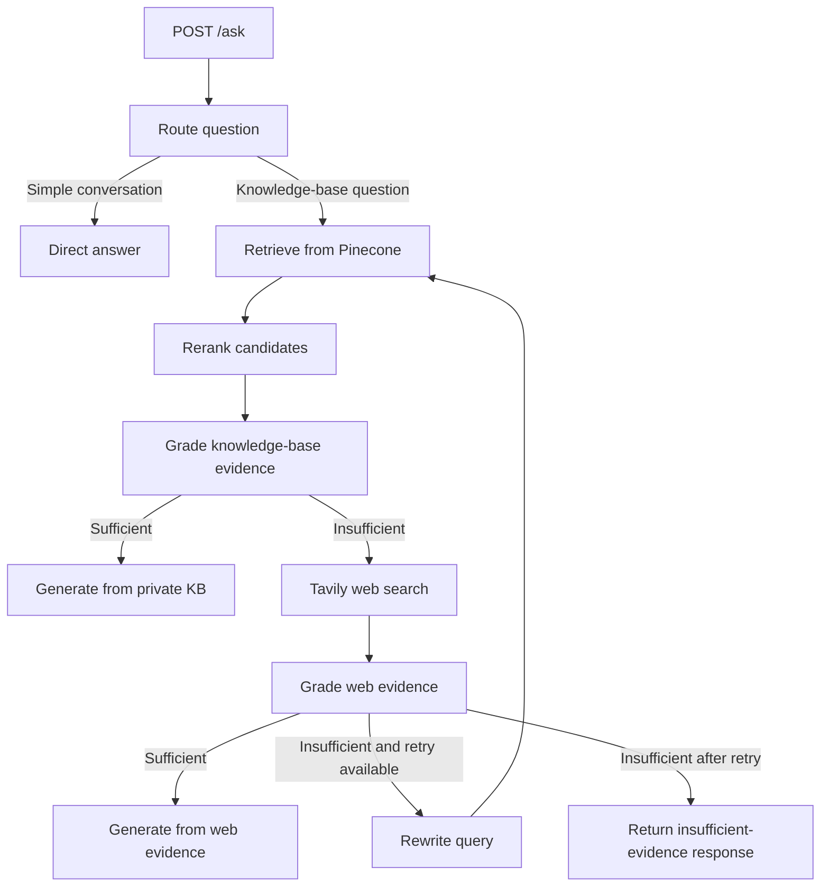

# Agentic RAG

An Agentic Retrieval-Augmented Generation (RAG) API built with FastAPI and
LangGraph. It routes questions to a private Pinecone knowledge base, reranks
retrieved passages, checks whether they answer the question, and falls back to
web search when the knowledge base is insufficient.

## Features

- FastAPI `POST /ask` endpoint.
- LLM-based routing for knowledge-base questions versus simple conversation.
- Pinecone vector search with Hugging Face sentence embeddings.
- Cross-encoder reranking of retrieved passages.
- LLM grading of knowledge-base and web evidence.
- Tavily web-search fallback, with one query rewrite/retry.
- Unit tests that run without external services and opt-in live integration
  tests for Pinecone, Groq, and Tavily.

## How the workflow works



For knowledge-base questions, the retriever is configured to return up to 10
candidates. A `BAAI/bge-reranker-large` cross-encoder ranks them, and up to four
passages are used for evidence grading and generation. Answers generated from
the private knowledge base or web search are constrained to their respective
evidence. Greetings and simple conversational messages can be answered directly.

## Project layout

```text
app/
  app.py                         FastAPI application and /ask endpoint
src/
  agent_graph/
    graph_workflow.py            LangGraph nodes and conditional edges
    nodes.py                     Routing, retrieval, grading, and generation
  chunking/
    chunker.py                   Splits source documents into chunks
  embeddings/
    embedder.py                  Hugging Face embedding model
  ingestion/
    loader.py                    Loads the source documentation
  llm/
    llm_client.py                Groq chat model
    web_search.py                Tavily search tool
  models/
    models.py                    API request and graph-state models
  vectordb/
    load_vectordb.py             Connects to the existing Pinecone index
    vectordb_creation.py          Creates/populates the Pinecone index
test/
  test_agent.py                  Unit and live integration tests
requirements.txt
```

## Requirements

- Python 3.12 (the version used by CI).
- A Groq API key.
- A Pinecone API key and access to a Pinecone index.
- A Tavily API key for web fallback and live integration tests.
- Network access to download the Hugging Face embedding and reranker models.

## Setup

Create and activate a virtual environment from the repository root.

### Windows PowerShell

```powershell
python -m venv .venv
.\.venv\Scripts\Activate.ps1
python -m pip install --upgrade pip
pip install -r requirements.txt
```

### macOS/Linux

```bash
python3 -m venv .venv
source .venv/bin/activate
python -m pip install --upgrade pip
pip install -r requirements.txt
```

Create a `.env` file in the repository root with your own credentials:

```dotenv
GROQ_API_KEY=your_groq_api_key
PINECONE_API_KEY=your_pinecone_api_key
TAVILY_API_KEY=your_tavily_api_key
```

Never commit `.env` or paste real credentials into source code. The `.env` file
is ignored by Git; configure the same values as repository secrets for CI.

## Pinecone knowledge base

The application loads an existing index named `industry-agentic-rag-kb` and
uses the `langgraph-agentic-rag` namespace. The embedding model is
`sentence-transformers/all-MiniLM-L6-v2` (384 dimensions, normalized vectors).

To create/populate the index from the configured source document, run:

```bash
python -m src.vectordb.vectordb_creation
```

This script loads the Agentic RAG documentation from
[LangGraph documentation](https://docs.langchain.com/oss/python/langgraph/agentic-rag),
splits it into 1,000-character chunks with 150-character overlap, creates the
Pinecone index if it does not exist, and uploads the chunks. It uses the
`us-east-1` AWS serverless region when creating a new index.

The ingestion script does not clear the namespace or assign stable document IDs.
Avoid rerunning it against the same namespace unless you intend to ingest the
content again. The application itself expects the index and namespace above to
exist before it starts.

## Run the API

Start the development server from the repository root:

```bash
uvicorn app.app:app --reload
```

The API is available at `http://127.0.0.1:8000`. FastAPI's interactive
documentation is at `http://127.0.0.1:8000/docs`.

### Ask a question

macOS/Linux (or Windows with `curl.exe`):

```bash
curl -X POST "http://127.0.0.1:8000/ask" \
  -H "Content-Type: application/json" \
  -d "{\"question\":\"How does the Agentic RAG workflow retrieve evidence?\"}"
```

Windows PowerShell:

```powershell
Invoke-RestMethod `
  -Uri "http://127.0.0.1:8000/ask" `
  -Method Post `
  -ContentType "application/json" `
  -Body '{"question":"How does the Agentic RAG workflow retrieve evidence?"}'
```

Example response:

```json
{
  "question": "How does the Agentic RAG workflow retrieve evidence?",
  "source_used": "private_kb",
  "answer": "..."
}
```

`source_used` indicates which path produced the response: `private_kb`,
`web_search`, `direct`, or `insufficient_evidence`. Questions that fail request
validation (for example, an empty question) receive FastAPI's validation error.

## Tests

Run the default suite:

```bash
python -m pytest test/ -v -s
```

The unit tests mock the graph boundary and run without API keys. Live integration
tests are skipped unless `RUN_AGENT_INTEGRATION=1`. When enabled, they:

1. Query Pinecone and check that it returns non-empty chunks related to Agentic
   RAG.
2. Call the actual `/ask` handler and workflow, check that the retriever and
   reranker run, and verify that the final answer uses the private knowledge
   base.

The live tests require `PINECONE_API_KEY`, `GROQ_API_KEY`, and `TAVILY_API_KEY`.
They make real external service calls and may incur usage charges.

### Run live tests locally

After adding the required credentials to `.env`, set the integration flag and
run the suite.

Windows PowerShell:

```powershell
$env:RUN_AGENT_INTEGRATION = "1"
python -m pytest test/ -v -s
```

macOS/Linux:

```bash
RUN_AGENT_INTEGRATION=1 python -m pytest test/ -v -s
```

GitHub Actions reads the API keys from repository secrets. Live tests run for
pushes and same-repository pull requests; forked pull requests run the offline
tests only because GitHub does not expose repository secrets to them.

## Configuration

The Pinecone index, namespace, source URL, model names, chunking settings, and
reranker candidate count are currently defined in the Python source files. Update
those values in their corresponding modules if you use a different knowledge
base or model.
